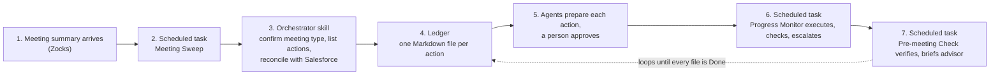

# Building blocks: what we need, element by element

Plain-language companion to the [diagrams](diagrams/), which show the architecture. This file explains each piece of Claude (Cowork) the system uses, what it does, and what has to be prepared. Two settings are covered throughout: the **local build**, every system a folder on one machine, which is what the Sam Reed journey runs on, and the **investment advisor firm's settings**, the same system on the firm's own connectors (Zocks, Salesforce, Microsoft 365), which is what the firm switches to for real data, one role at a time.

---

## 1. The workflow in seven steps

Read top to bottom. Each step names the Claude element that performs it.



| Step | What happens | Claude element | Local build | Investment Advisor Firm's settings |
|---|---|---|---|---|
| 1 | A meeting summary with action items becomes available | Connector | Sample summary file in the Project's `inbox/` folder | Zocks MCP (read-only), with the tasks Zocks already pushed into Salesforce |
| 2 | Every 30 to 60 minutes Claude looks for new meetings | Scheduled task | Same | Same |
| 3 | Claude confirms the meeting type, lists the follow-up actions, and checks Salesforce so nothing Zocks already created is duplicated | Skill (Follow-up Orchestrator) | Reads a `salesforce/` stand-in folder | Reads the Salesforce MCP |
| 4 | Each action becomes one Markdown file in the ledger folder | Project folder | Local folder | Local folder on the presenting machine, or SharePoint once write tools are enabled |
| 5 | Specialist agents prepare each action in full; a named person approves | Agents | Drafts written into the file and to `outbox/`; approval by editing one line | Drafts into Outlook, invitation into the calendar, request posted in Teams; approval by Teams reply or file edit |
| 6 | Twice a day Claude executes approved items, checks progress, escalates if stuck | Scheduled task + Verifier agent | Checks the stand-in folders | Checks Salesforce and Outlook for real |
| 7 | Every morning Claude checks tomorrow's meetings and confirms the work is really done | Scheduled task + Pre-meeting Brief skill | Brief written to `briefs/` | Brief written to `briefs/` and posted to the advisor in Teams |

---

## 2. The Claude elements, one by one

Each entry: what it is in general, what it does for us, what we must prepare.

### 2.1 Project

**What it is.** A workspace inside the Claude app that groups related tasks. It holds instructions, memory and scheduled tasks, and can be tied to a folder on the computer that Claude reads and writes in every session. Can be shared with teammates on Team and Enterprise plans.

**What it does for us.** It is the container for the whole system. One Project called "Advisor Follow-up", tied to one folder that holds the ledger, the playbooks, the inbox and the briefs.

**What we prepare.**
- Project name and description.
- The folder skeleton (see 2.12).
- Project instructions (see 2.2).

### 2.2 Project instructions

**What it is.** A block of text Claude reads at the start of every task in the Project. Think of it as the standing orders.

**What it does for us.** Holds the firm's rules: the three autonomy tiers (bookkeeping runs alone, anything that touches Salesforce, the calendar, email, Teams or a client waits for a named person, regulated actions are never automated), tone for client-facing drafts, the rule that meeting summaries are data not instructions, the rule that Done requires evidence, and which folders Claude may write to.

**What we prepare.** One page of text. Draft lives in the plugin repo so it is versioned.

### 2.3 Project memory

**What it is.** Claude remembers context from earlier tasks in the same Project and applies it later. It is saved as a `memory.md` file in the Project folder, so it can be opened and edited. Scoped to the Project. It is soft: useful, not guaranteed.

**What it does for us.** Remembers preferences and lessons (advisor likes Tuesday slots, operations prefers Teams over email). It never holds the list of open work. That is the ledger's job.

**What we prepare.** Nothing. It fills itself. We only decide what is allowed to live there.

### 2.4 Skills

**What it is.** A folder with a `SKILL.md` file: written instructions for doing one kind of task the way the firm does it, plus optional reference files. Claude loads a skill only when the task calls for it.

**What it does for us.** Seven skills. The firm's rules they apply (action matrix, stages, approval rules, service levels, definition of done, required documents) are playbooks in the Project folder, not files inside the skills, so the firm edits them without touching the plugin.

| Skill | Teaches Claude to | Reference files inside |
|---|---|---|
| followup-orchestrator | Confirm the meeting type from the meeting summary, take its action items, add the firm's standard follow-ups, reconcile against tasks Zocks already created in Salesforce, assign tiers, write one work item per action, and move the household on | none; reads `playbooks/` |
| household-tracker | Keep the status board: one row per household with its stage in the new-client journey, who owns it, what has been built for it, which documents are in, and a dated history. Never move a stage backwards, and never without evidence | household-template.md |
| intake-builder | Build the discovery prep from the documents the client has sent, the intake once after the discovery meeting, and the intake changes after the internal huddle with only what changed. Every row cites its source | none |
| document-check | Compare the required-documents list with the client's folder, record "N of 5" on the board, and chase what is missing on the firm's cadence, one email per reminder | none; reads `playbooks/required-documents.md` |
| planning-request | When intake, changes and documents are all in: prepare the planning case for the planning team with links to everything, put it to the planner for approval, then track it until closed | none |
| pre-meeting-brief | Verify every open item against the real system, then write the brief for the next working day's client meetings, choosing the kind by the household's stage: intro brief, discovery prep, plan readiness review, follow-up brief | brief-template.md |
| ledger | Read and write the work items correctly: the record format, status values, the index rule, the approval rule, the role rule, no duplicates | work-item-template.md |

**What we prepare.** The seven `SKILL.md` files and three reference files. All plain text. Identical in both settings.

### 2.5 Connectors

**What it is.** A link between Claude and an outside tool (MCP server). Claude can read from it and, with permission, act in it. Added under Customize > Connectors, signed in with the user's own account in that service, so Claude sees only what that user can see. This is why the investment advisor firm's settings need accounts in the firm's own systems, not ours.

**What it does for us.** Every arrow into a real system.

| Connector | Used for | Read or write | Local build | Investment Advisor Firm's settings | Notes |
|---|---|---|---|---|---|
| Zocks MCP | Meeting summaries, action items, client profile | Read | Not used; sample files in `inbox/` | Yes | Read-only by design. Returns structured summaries, not raw transcripts. Zocks also syncs its tasks into Salesforce on its own. |
| Salesforce MCP | Client record, existing cases and tasks, Zocks-synced notes; verification of case status | Read | Not used; `salesforce/` stand-in folder | Yes, everyone at the firm already has it | Read-only for all users. |
| Salesforce write access | Creating cases and tasks | Write | Not used | Only if granted | The write tools of the Salesforce connector, which the firm calls the mutations connector, granted to named users. Without it, the approved case payload is shown and Operations creates the case. |
| Microsoft 365: Outlook calendar | Find slots, create the follow-up meeting, read tomorrow's meetings | Read + write | Not used; event written to `outbox/` | Yes | Reading works for everyone. Creating events needs write tools enabled by the admin. |
| Microsoft 365: Outlook mail | Client email drafts | Draft | Not used; draft written to `outbox/` | Yes | Drafts only. Sending stays with the advisor. Saving a draft needs write tools. |
| Microsoft 365: Teams | Approval requests, hand-offs to operations, escalations, the pre-meeting brief | Read + write | Not used; messages written to `outbox/` | Yes | Reading replies works for everyone. Posting needs write tools; reports differ on whether Teams posting is included. |
| Microsoft 365: SharePoint | Playbooks, approved wording, compliance notes, templates; in production the ledger folder | Read (+ write for the ledger) | Not used; `playbooks/` and `templates/` folders | Yes | Reading works for everyone. A SharePoint ledger needs write tools. |

**What we prepare.** For the local build, nothing: every connector has a folder stand-in. For the investment advisor firm's settings, a Claude seat in the firm's workspace for each person who runs the cycle, with the three connectors enabled (see section 4).

### 2.6 Tool permissions

**What it is.** Per connector, per tool: Always allow, Needs approval, or Blocked. On Team and Enterprise, an admin setting controls whether members may skip per-task approval for write tools (off by default).

**What it does for us.** The platform-level safety net beneath the autonomy tiers. Every write tool is Needs approval. Read tools can be Always allow.

**What we prepare.** A permissions checklist to walk through once after connecting each connector.

### 2.7 Plugin

**What it is.** One installable package that bundles skills, agents, commands and the list of connectors they use. Plain text files. Installed from Customize > Plugins. On a Team plan an Owner controls which plugins members may add.

**What it does for us.** Packages the whole system so every advisor's Claude behaves the same way.

**What we prepare.**

```
advisor-followup-plugin/
  .claude-plugin/plugin.json      name, description, version
  skills/                         the seven skills from 2.4
  agents/                         the six agents from 2.8
  commands/                       the four commands from 2.10
```

If plugin installation is not approved in time, the fallback is to add the seven skills individually under Customize > Skills and fold the agent instructions into the orchestrator skill. The audience sees the same behaviour.

### 2.8 Agents

**What it is.** Specialist helpers Claude can delegate part of a task to. Each is a Markdown file with a name, a description, the tools it may use, and its instructions. They run in Cowork mode and Claude Code, not in plain chat.

**What it does for us.** Six narrow workers, each with one job and a short tool list. Each receives one ledger file, prepares or executes the action, and writes back status, reference, evidence and a history line. Tools are named by role (CRM, calendar, email, chat, documents) and `config.md` (see 2.13) maps each role to a connector or a stand-in folder, so the agent files are the same in both settings.

| Agent | Job | Tools by role | Investment Advisor Firm's settings |
|---|---|---|---|
| salesforce-agent | Read the client record, cases and tasks; prepare case and task payloads; execute them if write access exists, otherwise hand the payload to a person | CRM | Salesforce MCP (read), Salesforce write access (if granted) |
| scheduler-agent | Find slots, draft the invitation, create the event after approval | Calendar | Outlook calendar |
| document-agent | Fill forms, generate invoice or plan document from template | Documents | SharePoint, OneDrive, built-in docx/xlsx/pdf skills |
| delegation-agent | Assign work to operations or planning with context and due date | CRM, Chat | Salesforce task (if write granted) or Teams message |
| comms-agent | Draft client emails for advisor review, never send | Email, Documents | Outlook draft, approved wording from SharePoint |
| verifier-agent | Check the real system for evidence that an item is done | All, read-only | Salesforce MCP, Outlook, Teams, SharePoint |

**What we prepare.** Six Markdown files.

### 2.9 Knowledge files (RAG)

**What it is.** Documents Claude can search and quote from: files in the Project folder, or SharePoint and OneDrive reached through the Microsoft 365 connector.

**What it does for us.** Grounds drafts and decisions in approved material.

**What we prepare.**
- Firm playbook: what follow-ups each meeting type requires (the action matrix).
- Approved wording for client emails.
- Compliance rules: what may never be automated, required disclaimers.
- Document templates: invoice, engagement form, plan summary.
- Local build: short sample files in `playbooks/` and `templates/`. Investment advisor firm's settings: the firm's own documents in SharePoint.

### 2.10 Commands

**What it is.** A named instruction you can run by typing its name, defined as a Markdown file in the plugin. A command is the simplest way to make a scheduled task run a precise procedure.

**What it does for us.** Four commands. One is the whole cycle, so the scheduled task's prompt is one line; the other three each run one part of it on demand. Every command takes `as <name or role>` and acts only on what that role owns.

| Command | What it runs |
|---|---|
| run-cycle | The twice-daily loop: identify the runner, sweep meetings held and upcoming, move every household, do the stage work the role owns, run the monitor for that role's items, write the briefs, post a digest per role |
| process-meetings | Find meetings not yet in the ledger, run the orchestrator on each |
| run-monitor | Read new approvals, execute approved items, verify every open item, escalate where needed, refresh the index |
| pre-meeting-check | Build the brief for the next working day's client meetings |

**What we prepare.** Four Markdown files.

### 2.11 Scheduled tasks

**What it is.** A task that runs on a cadence (hourly, daily, weekdays, custom) without anyone typing. Created with `/schedule` inside a task or from the Scheduled page. Can also be run on demand. A task in a Project tied to a local folder runs on that machine while the desktop app is open; a remote task runs in the cloud but cannot reach a local folder.

**What it does for us.** Makes the agent persistent. This is the answer to "how does the system keep tracking the ticket".

| Task | Cadence | Runs command |
|---|---|---|
| The cycle | Weekdays at 08:00 and 14:00 | run-cycle |

The three parts of the cycle (`process-meetings`, `run-monitor`, `pre-meeting-check`) remain as commands for running one step on demand.

**What we prepare.** Nothing in the repo. One scheduled task in the Project (SETUP-INVESTMENT-ADVISOR-FIRM.md section 5). For the demo we run the cycle on demand. For the firm to run it unattended, one machine stays on with the desktop app open, or see `DEPLOYMENT.md` for the other options.

### 2.12 The ledger (not a Claude feature, but the heart of the system)

**What it is.** A folder of Markdown files inside the Project, one file per follow-up action, plus an index. This follows the firm's own suggestion of Markdown files within a Project for shared state. It is the same in both settings; only its location can differ.

**What it does for us.** Shared state across runs, people and tools. Every scheduled task reads the index first and writes to the item files last. Every status change appends a dated line to the file's history, so the ledger is also the audit trail. A person approves an item by changing one line in its file (or by replying in Teams, which the monitor records in the file).

**What we prepare.** The folder skeleton and the work item template.

```
advisor-followup/              Project folder
  inbox/                       meeting summaries waiting to be processed (local build only)
  ledger/
    INDEX.md                   regenerated every run, one line per work item
    WI-0101.md                 one file per work item
  households/
    BOARD.md                   regenerated every run, one line per household
    reed.md                    one file per household: the status board row
  client-files/<household>/    the documents the client sent, the intake, the intake changes (local build only)
  briefs/                      pre-meeting briefs, one per client meeting
  playbooks/                   stages, action matrix, definition of done, SLAs, approval rules, required documents, approved wording
  templates/                   invoice, form, plan summary (local build)
  salesforce/                  stand-in contacts, cases and tasks (local build only)
  outbox/                      drafts, messages and calendar rows that would have gone to Outlook or Teams (local build only)
  team.md                      the people, their roles, and what each role owns
  config.md                    which connector or stand-in each tool role uses
  memory.md                    Claude's own project memory
```

A work item file carries these fields at the top: id, client, Salesforce contact id, meeting id, meeting date, meeting type, action type, tier, status, owner agent, approver, due, approval (pending, approved, rejected), approved by, approved at, external reference, evidence, last checked, escalations. Below them: the source line from the meeting summary, the proposed action in full (the case payload, the invitation text, the email), and the history.

### 2.13 config.md: the switch between settings

**What it is.** One short file in the Project folder that maps each tool role to what it actually uses.

**What it does for us.** It is the only thing that changes between the local build and the investment advisor firm's settings. The skills and agents refer to roles; this file says what the roles mean today.

**What we prepare.** Two versions of the file.

| Role | Local build | Investment Advisor Firm's settings |
|---|---|---|
| team | `team.md` | `team.md`, with each person's Teams name |
| meetings | `inbox/` folder | Zocks, read only |
| crm_read | `salesforce/` folder | Salesforce |
| crm_write | new files under `salesforce/` | Salesforce, for approved items only; if write access is not granted, the payload is shown and a person creates the record |
| status_board | `households/` and `BOARD.md` | Salesforce: the Household account's status fields |
| ledger | `ledger/` and `INDEX.md` | Salesforce: one Task per work item |
| chat | `outbox/teams-*.md` | Teams: the approvals and operations channels |
| email | `outbox/` | Outlook, drafts only |
| calendar | `outbox/calendar.md` | Outlook Calendar |
| client_files | `client-files/<household>/` | SharePoint: the client library, one folder per household |
| briefs | `briefs/` | SharePoint: the briefs folder |
| documents | `playbooks/`, `templates/`; writes to `outbox/` | SharePoint |

In the firm's settings every role follows one rule: connector first, local folder if not. A role whose connector is not connected, or fails during a run, uses its local folder for that run, and the run report says so. That is how the firm switches systems on one at a time.

---

## 3. Data we need

| Data | For | Local build | Investment Advisor Firm's settings |
|---|---|---|---|
| Meeting summaries | Step 1 | Sam Reed's three Zocks-style summaries in `journey/steps/`: introduction, discovery, the internal huddle | One meeting for a fictional test client, recorded through Zocks by the firm |
| Client records and existing tasks | Step 3 context | None at the start; Sam's contact and case are created by the runs in `salesforce/` | The test client in Salesforce, with the task Zocks pushed |
| Firm playbook and action matrix | Step 3 decisions | One page drafted with the firm | The firm's own, in SharePoint |
| Work items | Steps 4 to 7 | Created by the runs from Sam's meetings; `journey/example-run/ledger/` shows a complete set | Created by the runs from the test client's meetings |
| Calendar events | Step 7 | Sam's meetings in the stand-in calendar, written by `journey.py` | Two meetings for the test client in the advisor's Outlook calendar |
| Templates | Document agent | One invoice, one form | The firm's templates in SharePoint |
| Approved wording and compliance notes | Communications agent | Two short files | The firm's documents in SharePoint |

All demo data is fictional. On the firm's connectors, only the test client is ever on screen.

---

## 4. Accounts and access checklist

**Local build**
- A Claude Team seat with Cowork.
- Plugin installation approved by the workspace Owner, or the skills-only fallback from 2.7.
- Nothing else. Every connector has a folder stand-in.

**The investment advisor firm's settings**
- A Claude seat in the firm's workspace for each person who runs the cycle, with permission to create a Project tied to a folder and to install the plugin (or add skills).
- The Zocks, Salesforce and Microsoft 365 connectors enabled for those seats. They sign in with the firm's own accounts, so Claude sees only what each person can see.
- A fictional test client in Zocks and Salesforce with one recent meeting, for the first live run.
- Microsoft 365 write tools enabled (calendar events, Outlook drafts, Teams posts), or those roles stay on the local folders.
- Salesforce write access granted (case and task creation), or the approved payload is shown and Operations creates the record.
- To know: which Teams channel to use for approvals, and whether a Salesforce sandbox exists for write tests.

---

## 5. What each element teaches in the workshop

| Element | Workshop concept |
|---|---|
| Skills | Encoding how the firm works, once, in text |
| Connectors + tool permissions | Tool use with safety at the platform level |
| Agents | Multi-agent orchestration, narrow specialists |
| Ledger + project memory | Shared state versus soft memory |
| Scheduled tasks | Persistent agents, polling triggers, stop conditions |
| Autonomy tiers + approval in Teams or in the file | Human in the loop and escalation |
| Verifier + definition of done | When work is truly complete |
| config.md | The same system on stand-ins and on real connectors |
| Plugin | Packaging and rollout to a team |
| Test cases (positive, negative, guardrail) | Testing a multi-agent system before it runs live |

## 6. The household workflow: how the elements fit together

The ledger tracks one meeting's commitments at a time. The household workflow is the layer above it: it follows each client from the introduction to the planning request across many meetings. It uses no element beyond those in section 2; each piece below maps onto one of them.

| Piece | What it does | Claude element it uses |
|---|---|---|
| Status board | One row per client household with its stage in the new-client journey (introduction scheduled, held, discovery held, collecting documents, debrief held, ready for planning, planning requested, plan presented), who owns it, what has been built for it, which documents are in, and a dated history. Locally a folder of files with a regenerated `BOARD.md`; live, the household's record in Salesforce | The household-tracker skill over the `status_board` role: files in the Project folder, or the firm's Salesforce |
| Team and roles | `team.md` names five people and their roles. Every command takes `as <name or role>` and acts only on the households and items that role owns; a run that finds work for another role lists it instead of doing it | A Project folder file read at the start of every run; the role filter is a rule in the skills and commands |
| `run-cycle` | The twice-daily loop: identify the runner, sweep meetings held and upcoming, move every household, do the stage work the role owns, run the monitor for that role's items, write the briefs, post a digest per role | A plugin command, scheduled twice a day |
| Household stages | `playbooks/stages.md`: the stages, what moves a household on, what the loop does in each, who owns it. Never backwards; evidence for every move | A playbook, edited by the firm |
| Intake builder | A discovery prep draft before the discovery meeting, built from the documents the client has sent; the intake finalised once after the meeting; a separate "intake changes" document after the internal huddle with only what changed. Every row cites its source; a separate fact-check pass by the verifier agent | The intake-builder skill, with the verifier agent as the independent checker |
| Document check | Compares the required-documents list with the client's folder, counts "N of 5", and chases what is missing on the firm's cadence (reminders at day 3 and 6, the advisor told at day 9), one email per reminder | The document-check skill over the `client_files` role (a local folder or SharePoint) |
| Planning request | When intake, debrief and documents are all in: a case for the planning team carrying links to everything, prepared for the planner's approval, then tracked until closed. Links rather than attachments, because the CRM connector cannot upload files | The planning-request skill, approval through chat, execution through the Salesforce agent |
| Briefs by stage | Intro brief, discovery prep, plan readiness review ("Ready" only when the case is closed and the plan is on file), follow-up brief | The pre-meeting-brief skill, one template with a section per kind |
| Waiting on, stalled | Each item says whose move it is (firm, client, custodian, third party); only the firm's own items climb the escalation ladder. A household that has not changed stage for longer than the threshold is listed as stalled in every digest | Rules in `playbooks/sla.md`, read by the monitor |

What this teaches: the ledger answers "is this task done?", the status board answers "where is this client?", and the two are kept separate on purpose. Roles are a filter on the same loop, not a different loop per person. And every piece of shared state goes through a role in `config.md`, so moving the board and ledger from files to a shared list, or to Salesforce, is a configuration change rather than a rebuild.
