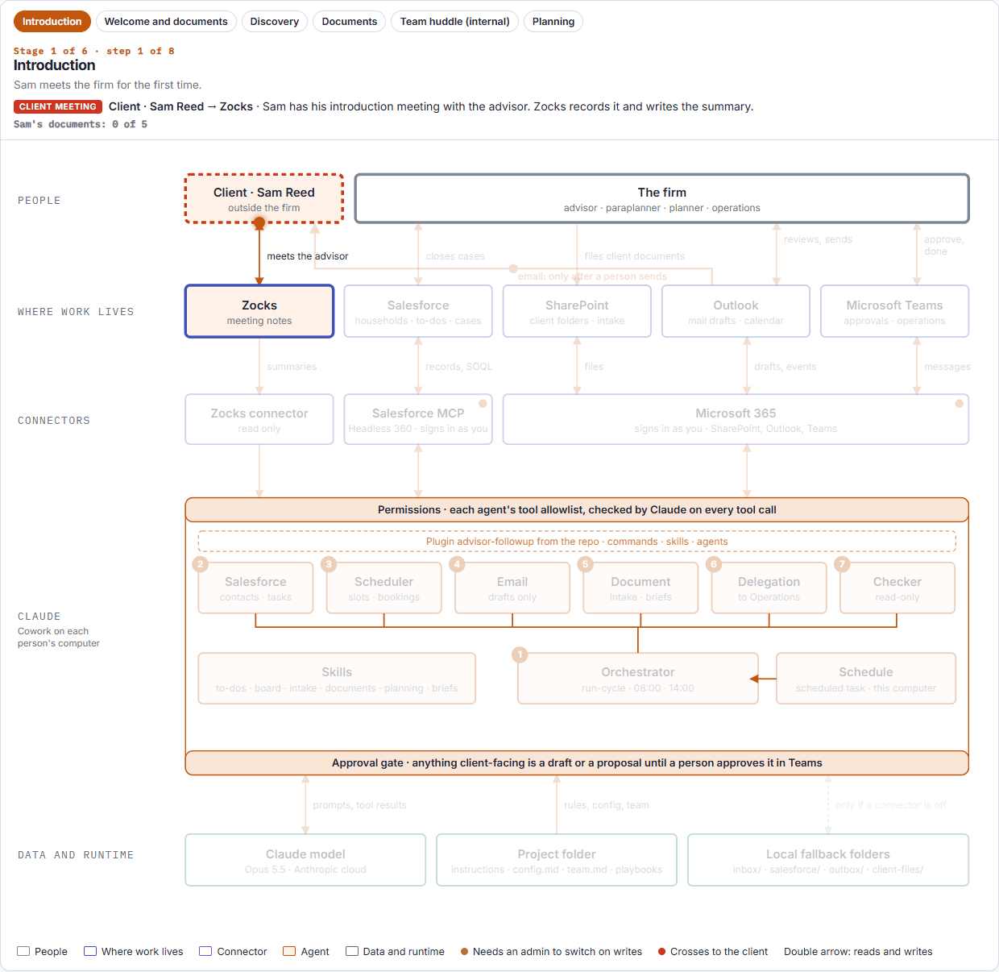

# Designing shared multi-agent workflows with Claude

A working example of a shared multi-agent workflow for an investment advisor firm, built with Claude Cowork. It carries each new client household from the introduction meeting to the planning request, and keeps every existing client's follow-ups on track. Twice a day it finds the meetings held and coming up, works out which stage every household is at, turns each meeting's commitments into tracked work items, builds the client intake once and records only what changed after the internal huddle, checks which documents the client has sent and chases the rest, prepares every action for a person to approve, carries out what is approved, verifies that work is really done, and briefs the advisor before each meeting. It knows who is running it and acts only on what that person's role owns.

It is built entirely from standard Claude Cowork pieces: a Project tied to a folder, a plugin with skills, agents and commands, connectors, and scheduled tasks. The shared state is two lists: a status board (one row per household) and a ledger (one record per work item), kept as files in the project folder or as records in the firm's own systems, depending on the setting.



A still version of this picture, the written description and the other diagrams are in [diagrams/](diagrams/). An interactive version opens in any browser: [diagrams/architecture.html](diagrams/architecture.html) (download it and double-click).

## Start here

| If you want to | Read |
|---|---|
| Set it up, play one client's journey, then connect your own systems | [SETUP-INVESTMENT-ADVISOR-FIRM.md](SETUP-INVESTMENT-ADVISOR-FIRM.md) |
| Understand each Claude piece and why it is used | [BUILDING-BLOCKS.md](BUILDING-BLOCKS.md) |
| See what each skill, agent and command in the plugin does | [advisor-followup-plugin/README.md](advisor-followup-plugin/README.md) |
| See the system as pictures | [diagrams/](diagrams/) |
| Plan running it for real | [DEPLOYMENT.md](DEPLOYMENT.md) |

## Quick start

1. Clone the repository into a folder named `advisor-followup-system` and go into it:
   ```
   git clone --branch investment-advisor --single-branch https://github.com/traversaal-ai/traversaal-trainings.git advisor-followup-system
   ```
   ```
   cd advisor-followup-system
   ```
2. Create the working folders and a local `config.md` (macOS: `python3`):
   ```
   python reset-demo.py
   ```
3. Follow section 2 of [SETUP-INVESTMENT-ADVISOR-FIRM.md](SETUP-INVESTMENT-ADVISOR-FIRM.md): the Claude app, the project, the plugin, then `journey.py`, which plays one made-up client, Sam Reed, from the introduction meeting to the planning request. Every system is a local folder; nothing real is touched.
4. When that works, sections 3 to 5 of the same guide connect your own systems one at a time.

## What is in the repository

| Path | What it is |
|---|---|
| [advisor-followup/](advisor-followup/) | The folder the Claude Cowork project is tied to: instructions, the two configuration templates, the team list, playbooks and document templates. [FOLDER-GUIDE.md](advisor-followup/FOLDER-GUIDE.md) explains every file |
| [advisor-followup-plugin/](advisor-followup-plugin/) | The plugin: seven skills, six agents, four commands (`run-cycle` is the twice-daily loop; the other three run one part of it). Zip it and upload it in Claude (SETUP-INVESTMENT-ADVISOR-FIRM.md step 2.3) |
| [reset-demo.py](reset-demo.py) | First-time setup: creates the working folders and your local `config.md` |
| [journey.py](journey.py), [journey/](journey/) | Plays Sam Reed's journey one step at a time on local files: his meeting notes and documents in `journey/steps/`, and a complete run to compare with in `journey/example-run/` |
| [salesforce-ledger/](salesforce-ledger/) | Optional, for the firm's Salesforce only. The fields the status board expects on the Household account, plus a Follow-up Item object for keeping the ledger in Salesforce later. A Salesforce admin deploys them once when the board moves into the firm's org; a firm that already tracks the same things with its own fields points the status board row in `config-investment-advisor-firm.md` at those instead. Not used by the local run |
| [diagrams/](diagrams/) | The diagrams: the end-to-end workflow (a PNG and a GIF), one client end to end, and the life of a work item |
| [SETUP-INVESTMENT-ADVISOR-FIRM.md](SETUP-INVESTMENT-ADVISOR-FIRM.md) | The setup guide: the local run first, then the firm's own systems |
| [BUILDING-BLOCKS.md](BUILDING-BLOCKS.md), [DEPLOYMENT.md](DEPLOYMENT.md) | How it works, and the options for running it for real |

All client data in this repository is fictional.
