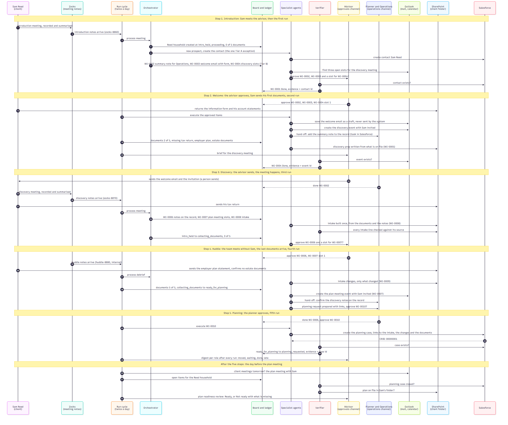

# Advisor Follow-up System

## Sequence: One Client, End to End

### Purpose

The architecture overview describes the parts of the system. This document follows one client through it, from the introduction meeting to the planning request, and shows the rhythm the system runs on: a person does something, a run happens, something appears. It is the same journey the repository plays locally with `journey.py`, in the same five steps, with the same work item numbers.

### Scenario

A prospect, Sam Reed, meets the advisor for an introduction and agrees to proceed. Over the following days he returns the client information form, sends his statements and his tax return, has his discovery meeting, and the team holds its internal huddle about him. The firm's side is the advisor, who approves and sends; Operations, who update the client record; and the planner, who approves the planning request.

### Summary

Each of the five steps is one band in the picture. The people's part comes first in each band (notes arrive, the advisor approves, documents are sent), then one run of the cycle does the stage's work: records what the firm owes Sam, prepares each action in full, asks the right person, carries out what was approved, and has the verifier confirm the result in the real system. The board moves Sam from introduction held to collecting documents, to ready for planning, to planning requested, and every move cites its evidence. A last band, beyond the five steps, shows the readiness review on the day before the plan meeting.

---

## Participants

| Participant | Role in this sequence |
|---|---|
| Sam Reed | The client. Meets the advisor, sends documents, receives the emails a person sends |
| Zocks | Where the meeting notes appear, for client meetings and for the internal huddle |
| Run cycle | The one scheduled loop, run about twice a day. Five runs cover the whole journey |
| Orchestrator | Reads each summary, decides the stage and the required actions |
| Board and ledger | The status board (one row for the Reed household) and the work items (WI-0001 to WI-0010) |
| Specialist agents | Salesforce, scheduler, communications, document and delegation agents, each taking one item |
| Verifier | Checks each item against the real system and fact-checks the intake. The only agent allowed to set Done |
| Advisor | Approves in the approvals channel, sends the drafts, receives the brief and the digests |
| Planner and Operations | The operations channel: Operations take hand-offs and reply done; the planner approves the planning request |
| Outlook | Mail drafts and the calendar |
| SharePoint | Sam's client folder: his documents, the discovery prep, the intake and the intake changes |
| Salesforce | His contact, the tasks for Operations, the planning case |

---

## Step 1: Introduction (first run)

1. Sam meets the advisor. Zocks records the meeting and writes the summary.
2. The notes arrive and the cycle picks them up.
3. The Orchestrator processes the meeting.
4. The Reed household is created on the board at introduction held, proceeding, with 0 of 5 documents on file.
5. Because Sam is a new prospect from an introduction, the contact is created without approval: the one Tier A exception, after duplicate checks.
6. The Salesforce agent creates the contact.
7. Three Tier B items are written: a summary note for Operations (WI-0002), the welcome email with the information form and the document checklist (WI-0003), and the discovery meeting (WI-0004).
8. The scheduler finds three open slots.
9. The advisor is asked to approve the three items and pick a slot.
10. The verifier checks that the contact exists.
11. WI-0001 is Done, with the contact id as evidence.

## Step 2: Welcome (second run)

12. The advisor approves all three in the approvals channel, choosing slot 1.
13. Sam returns the information form and his account statements.
14. The cycle executes the approved items.
15. The welcome email is saved as a draft in Outlook. The system never sends.
16. The discovery event is created with Sam as attendee, so the approved invitation goes out from the advisor's calendar.
17. The summary note is handed to Operations with a due date and a task in Salesforce.
18. The document check records 2 of 5 and names the three still missing.
19. The discovery prep is written from what is on file (WI-0005) and saved in Sam's folder.
20. The advisor receives the discovery prep as the brief for the meeting.
21. The verifier checks that the event exists.
22. WI-0004 is Done, with the event id as evidence.

## Step 3: Discovery (third run)

23. The advisor sends the welcome email and the invitation. A person sends; the system only drafts.
24. Operations reply done for the summary note.
25. Sam has his discovery meeting. Zocks records it.
26. The discovery notes arrive.
27. Sam sends his tax return.
28. The Orchestrator processes the meeting.
29. Three items are written: the discovery notes on the record for Operations (WI-0006), the plan meeting (WI-0007), and the intake (WI-0008). The documents Sam still owes are linked to the open request; no second email.
30. The intake is built once, from the documents on file and the notes.
31. The verifier checks every intake line against its source.
32. The board moves from introduction held to collecting documents, 3 of 5.
33. The advisor is asked to approve the hand-off and pick a plan meeting slot.

## Step 4: Huddle (fourth run)

34. The advisor approves both, choosing slot 1.
35. The team holds its huddle about the Reed household, without Sam. The notes arrive as a debrief.
36. Sam sends his employer plan statement and confirms he has no estate documents.
37. The Orchestrator processes the debrief.
38. The intake changes are written: only what changed since the intake (WI-0009). The intake itself is never rewritten.
39. The document check records 5 of 5, and the board moves to ready for planning.
40. The plan meeting event is created with Sam invited.
41. The discovery-notes hand-off goes to Operations.
42. The planning request is prepared with links to the intake, the changes and the documents, and put to the planner in the operations channel.

## Step 5: Planning (fifth run)

43. Operations reply done; the planner approves the planning request.
44. The cycle executes WI-0010.
45. The Salesforce agent creates the planning case, carrying links rather than attachments.
46. Salesforce returns the case number.
47. The verifier checks that the case exists.
48. The board moves to planning requested, with the case id as evidence.
49. After every run, each role receives a digest: what moved, what is waiting for them, what was done, what is late.

## After the five steps: the day before the plan meeting

The demo stops at planning requested. The last band shows what the cycle does on the working day before the plan meeting, once the planning team has had its turn.

50. The cycle reads tomorrow's calendar and finds the plan meeting with Sam.
51. It pulls every item for the Reed household.
52. The verifier checks that the planning case is closed.
53. The verifier checks that the plan is on file in Sam's folder.
54. The advisor receives the plan readiness review: "Ready", or "Not ready" with exactly what is missing. A case still open, or a plan not yet filed, is enough for "Not ready".

---

## What This Sequence Demonstrates

**The rhythm is person, run, result.** Nothing happens between runs on its own, and nothing in a run reaches a client. The people's part is visible in every band: approvals, sends, documents arriving.

**One client, ten items, one place.** Every commitment from three meetings is a work item in the same ledger, and the board answers "where is Sam?" at any moment, with the evidence for each move.

**Approval sits where it matters.** The contact is the one thing created without asking, and only after duplicate checks. Everything else that touches the CRM, the calendar, the channels or the client is prepared in full and waits for the named person.

**Done means verified.** The contact, the event and the case are each confirmed by the verifier in the real system before their items close. The intake is fact-checked line by line, and the huddle produces a changes document rather than a rewrite.

**The journey compresses.** In the local demo the five steps take one sitting; the document reminders on days 3, 6 and 9 never fire because everything arrives in time. In real use the same five runs are spread over weeks, with many more runs in between that find nothing to do for Sam.

---

## Mapping to Requirements

| Requirement | Where it appears in this sequence |
|---|---|
| Understand the meeting type and client context | Steps 3, 4, 28, 37 |
| Determine the required next actions | Steps 7, 29, 38, 42 |
| Delegate work to specialised agents or prompt the appropriate person for approval | Steps 5 to 9, 14 to 17, 33, 40 to 42 |
| Maintain memory and state across systems and teams | Every write to the board and ledger: 4, 7, 11, 18, 22, 29, 32, 39, 48 |
| Monitor whether work is progressing | Steps 10, 21, 24, 43, 47 |
| Escalate when something is blocked | Not reached in this journey: nothing stalls. See the work item lifecycle for the ladder |
| Verify work is complete before the next client interaction | Steps 19 to 22 (the brief before discovery), 31, 47 and 48, and 50 to 54 (the readiness review before the plan meeting) |

---

## Companion Diagrams

**Architecture.** The components of the system and how they connect.

**Work item lifecycle.** The states a single follow-up item passes through, from Proposed to Done, and the rule that an item is only Done when evidence exists in the underlying system.
