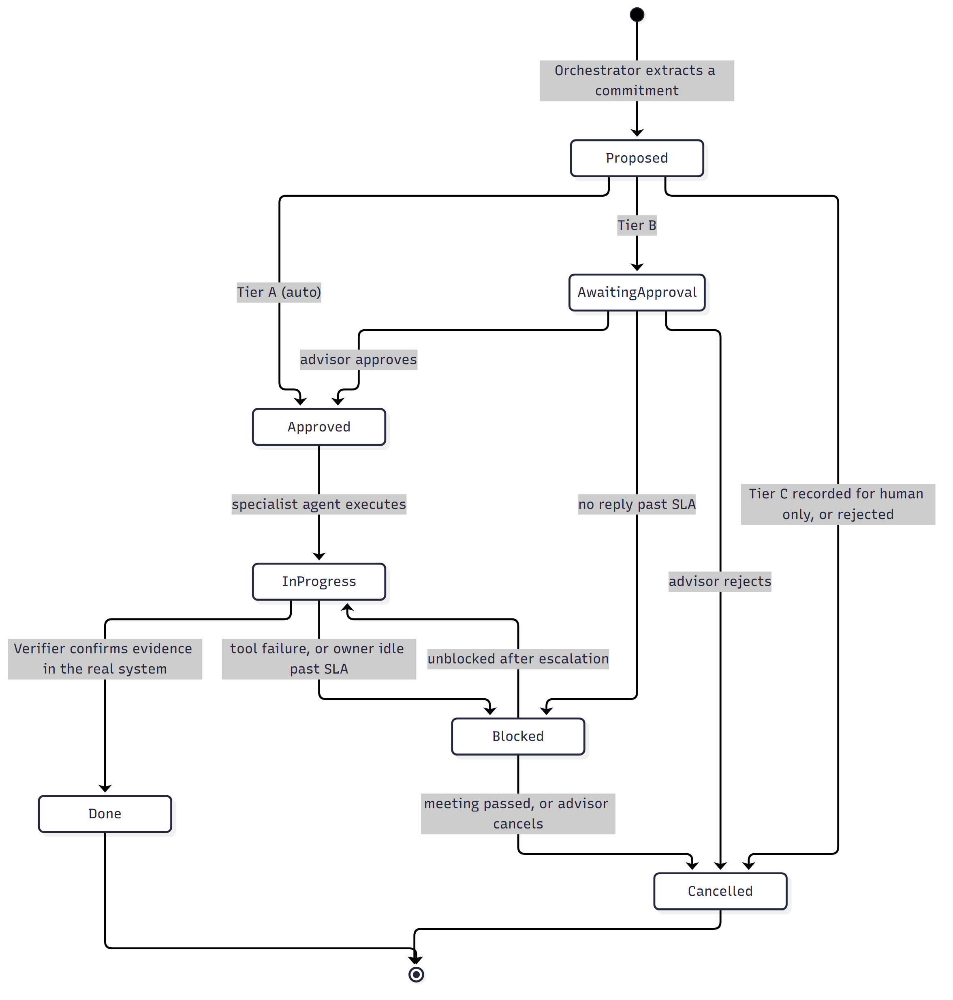

# Advisor Follow-up System

## Work Item Lifecycle

### Purpose

Every promise made in a client meeting becomes one work item: a single row in the shared ledger. The architecture overview shows where that ledger sits, and the sequence document shows two items moving through it over several days. This document describes the rules that govern every item, regardless of what it is: the states it can be in, what moves it from one state to the next, and what it takes for an item to be considered complete.

These rules answer the question raised directly by the investment advisor firm: how does the system determine when work is truly complete?

### Summary

An item starts as Proposed. Depending on its type it either proceeds on its own or waits for the advisor's approval. Once approved it is In Progress while a specialist agent or a team works on it. It becomes Done only when the system finds evidence of completion in the underlying system. If it stalls, it becomes Blocked and is escalated. Every change of state is recorded in the ledger, so the ledger is also the audit trail.

---

## The Seven States

| State | Meaning |
|---|---|
| Proposed | The item has been identified from a transcript and written to the ledger. No action has been taken. |
| Awaiting Approval | The item is client-facing or commits the firm, so it is waiting for the advisor's decision. |
| Approved | The item is cleared to proceed, either automatically (bookkeeping inside the ledger) or by the approver. |
| In Progress | A specialist agent or a team is working on it. An external reference exists, such as a Salesforce case number. |
| Blocked | The item has stopped moving. Either nobody has acted within the agreed service level, or a tool failed. |
| Done | Evidence of completion has been found in the underlying system and recorded. |
| Cancelled | The item will not be completed: the advisor rejected it, the client meeting has passed, or it was recorded for a human to handle outside the system. |

Done and Cancelled are final. An item in any other state is open and is checked by the Verifier on every run of the cycle.

---

## How Items Move Between States

### From Proposed

Every item begins here. Where it goes next depends on its autonomy tier, which the orchestrator assigns when the item is created.

| Tier | Rule | Next state |
|---|---|---|
| Tier A | Bookkeeping inside the ledger only. Examples: creating and updating work item files, regenerating the index, writing a brief file. | Approved, automatically |
| Tier B | Anything that touches the CRM, the calendar, email, chat or a client. Examples: creating a case or task, a meeting invitation, a client email, a form, an invoice, a message assigning work. | Awaiting Approval |
| Tier C | Regulated or irreversible. Examples: money movement, changes to account terms, investment advice, anything requiring a signature. | Cancelled, with the item recorded for a human to handle. The system never executes these. |

### From Awaiting Approval

- The advisor approves: the item becomes Approved.
- The advisor rejects: the item becomes Cancelled.
- No reply within the agreed service level: the item becomes Blocked and enters the escalation path.

### From Approved

A specialist agent picks up the item and begins work. The item becomes In Progress and the external reference (case number, calendar event, document link) is recorded.

### From In Progress

- The Verifier finds evidence of completion in the underlying system: the item becomes Done.
- A tool fails, or the owner has not acted within the agreed service level: the item becomes Blocked.

### From Blocked

- Escalation produces action and the item starts moving again: it returns to In Progress.
- The client meeting has passed, or the advisor cancels it: the item becomes Cancelled.

---

## What Counts as Done

An item is never marked Done by the agent that performed the work. It is marked Done only when the Verifier finds evidence in the underlying system. The evidence required depends on the type of item.

| Type of item | Evidence required |
|---|---|
| Salesforce case | Case status is Closed or Resolved, with a resolution note |
| Follow-up meeting | The event exists on the calendar and the client has been invited |
| Form sent to client | The client's response has been received, not merely that the form was sent |
| Invoice | The invoice has been sent and, where applicable, paid |
| Task assigned to a team | The assignee has marked it complete and attached the output |
| Client email | The approved text has been sent |

This distinction matters. A ticket that has been created is not finished. A form that has been emailed has not been returned. The system records the difference so the advisor is never told something is done when it is only started.

---

## Blocked Items and Escalation

When an item has passed its service level with no movement, the cycle escalates in three steps, with at least one business day between each:

1. A reminder to the owner of the item (for example, the operations team).
2. A notification to the advisor.
3. A notification to the advisor's manager.

Each escalation is counted in the ledger. After the third, the system stops escalating, sets the item Blocked, and lists it at the top of every brief until a person resolves it. This cap prevents an endless loop of reminders and makes clear when human intervention is required.

Escalation also stops when the item becomes Done or Cancelled, or when the related client meeting has already taken place.

---

## Mapping to Requirements

| Requirement | Where it appears in the lifecycle |
|---|---|
| Delegate work to specialised agents or prompt the appropriate person for approval | The tier rules from Proposed; the Awaiting Approval state |
| Maintain memory and state across systems and teams | Every state change recorded in the ledger |
| Monitor whether work is progressing | The Verifier's checks on every open item, each cycle |
| Escalate when something is blocked | The Blocked state and the three-step escalation path |
| Verify work is complete before the next client interaction | The evidence rules for Done |

---

## Companion Diagrams

**Architecture.** The components of the system and how they connect, organised in four layers.

**Sequence.** One client, Sam Reed, followed from the introduction meeting to the planning request, showing ten items moving through these states from creation to verified completion.
