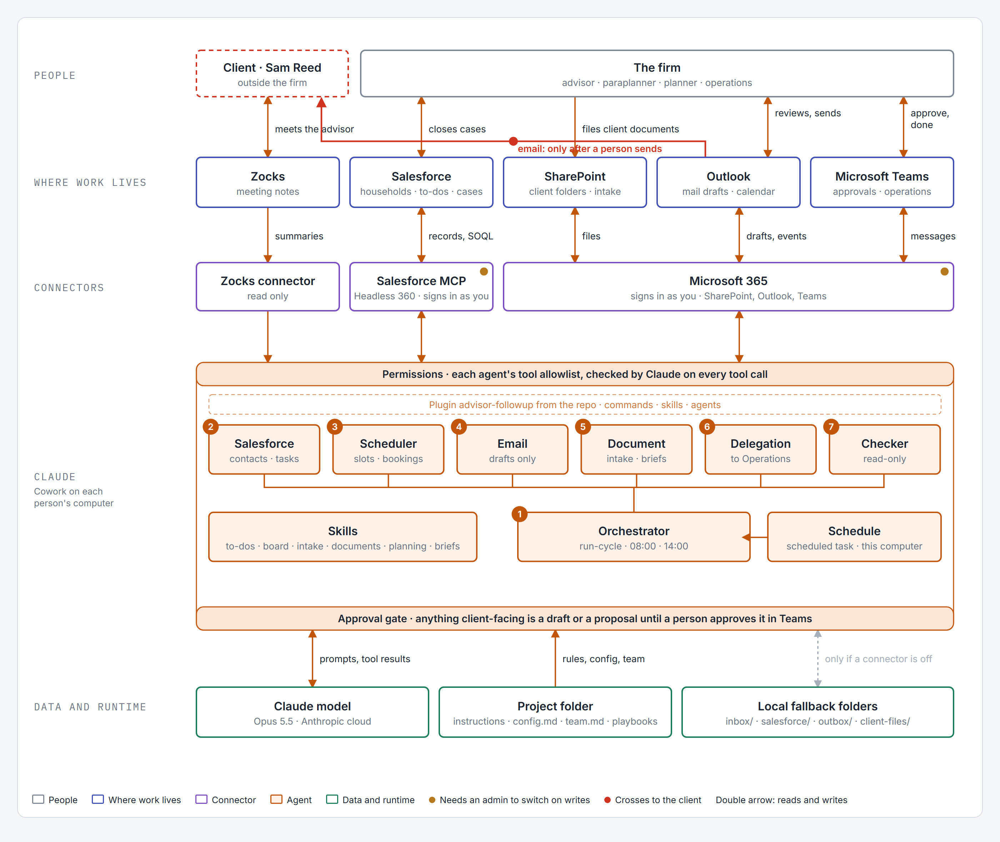

# Diagrams

Three pictures of the system. Each image is below; click one to open it full size.

## 1. End-to-end workflow

The whole system in five rows: the people (the client and the firm), where the work lives (the firm's own systems), the connectors Claude reaches them through, Claude itself (the orchestrator that runs twice a day, the six agents and the skills, inside a permissions band and an approval gate), and the data and runtime underneath. Meeting summaries come in, the orchestrator decides what the firm owes the client and hands each job to one agent, the agents act in the firm's tools and ask a person where needed, and the cycle keeps every household moving and every item checked until it is verified done.



Written description: [01-complete-workflow.md](01-complete-workflow.md). Animated version, one new client's journey playing through the same diagram from the introduction meeting to the planning request: [01-complete-workflow.gif](png/01-complete-workflow.gif). Interactive version: [architecture.html](architecture.html), opened in a browser (download it and double-click). It has a Play button for the journey, an "All agents" view, and a light and dark switch.

## 2. One client, end to end

Sam Reed followed from the introduction meeting to the planning request, in the five steps the local demo plays. In each step a person acts (notes arrive, the advisor approves, documents are sent), then one run prepares, asks, executes and verifies. A last band shows the readiness review on the day before the plan meeting.


Written description: [02-client-journey-sequence.md](02-client-journey-sequence.md).

## 3. The life of a work item

The states one follow-up item passes through, from Proposed to Done, and the rule that an item is only Done when there is evidence in the real system.


Written description: [03-work-item-state-machine.md](03-work-item-state-machine.md).

---

## Optional: editing the diagrams

Only needed to change a diagram. The images above are what to use.

| Folder | What is in it |
|---|---|
| `png/` | The images shown on this page. The workflow image and the animated version are captures of `architecture.html` |
| `source/` | The `.mmd` files for diagrams 2 and 3 (Mermaid, a text format for diagrams) |
| `architecture.html` | The interactive workflow and the source of its two pictures: a single page with no dependencies beyond web fonts. Edit it in any text editor |

To re-export a Mermaid diagram after editing it (one command per diagram, from the repository root):

```
npx --yes -p @mermaid-js/mermaid-cli mmdc -i diagrams/source/02-client-journey-sequence.mmd -o diagrams/png/02-client-journey-sequence.png -s 3 -b white
```

To re-make the workflow pictures after editing `architecture.html`, open it in a browser in light mode and take a screenshot of the diagram for the still image, or a screen recording of the Play button for the animated version. Alternatively paste a `.mmd` file's contents into https://mermaid.live to view or export it in a browser.
